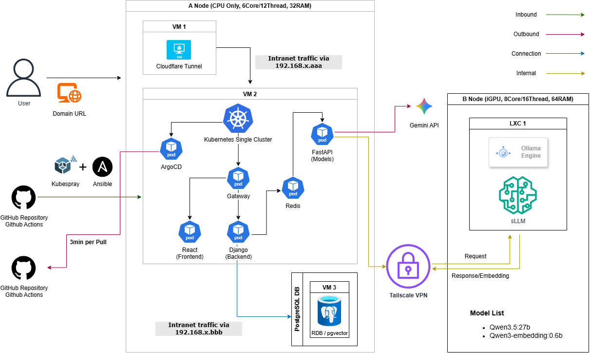

# haema's Home Lab

공식 경제 데이터를 근거로 답하는 검증형 RAG 질의응답 서비스입니다. 사양이 고정된 홈랩 노드 두 대에서 돌아갑니다. 질문은 워커가 비동기로 처리하고, 답변에 나온 수치는 모두 코드가 인용 근거와 대조합니다. 검증을 통과한 답변만 저장되고 사용자에게 보입니다.

> 이 문서의 수치는 출처를 함께 적었습니다. **실측(날짜)**은 직접 잰 값이고, **이전 측정**은 예전에 재고 이번에 다시 재지 않은 값입니다. 측정하지 않은 값은 `-`로 둡니다.

## 🏛️ 시스템 구성



> 이 그림은 재설계 이전 버전입니다. 현재 구조는 아래 [요청 흐름](#-요청-흐름)을 보세요.

## 🔀 요청 흐름

```
1. 브라우저 → Cloudflare Tunnel → Gateway
2. Gateway ─ 페이지 요청 → Frontend (정적 파일)
           └ /api/**    → Django API   (기본 꺼짐. 로그인이 아직 없어 Gateway 가 X-User-Id 를 넣는다)
3. Django API: 입력 검증(300자 이하, 본문 2,048바이트 이하), 유저당 처리 중 질문 상한(3개 초과 → 429 Retry-After 30)
   ├ 대화·메시지 조회 ─────→ DB, 바로 응답
   └ 새 질문 → 메시지 저장(pending) → Redis Stream chat:jobs:stream 에 XADD → 202   ← 큐에 넣는 곳은 여기 하나
4. Django 워커 (API 와 같은 이미지, manage.py run_worker, 컨슈머 그룹 workers): job 하나를 끝까지 처리
   ① 완전 일치 답변 캐시               → 있으면 재사용, 끝
   ② FastAPI /embed      (GPU 슬롯)   → 질문 벡터
   ③ 유사 답변 캐시 (pgvector)         → 있으면 재사용, 끝 (기본 꺼짐: 임계값 미보정)
   ④ 근거 청크 pgvector 검색 (상위 4개) → 근거 2,000자 이하. 근거 없음 → failed (no_evidence)
   ⑤ FastAPI /generate   (GPU 슬롯)   → qwen3.5:27b
   ⑥ 코드 검증 (core/verify.py)        → 실패 → rejected, 보여주지 않음
   ⑦ 답변 저장. 근거를 인용한 답만 답변 캐시에 저장 ("확인할 수 없음" 답은 캐시하지 않음)
   ⑧ 결과가 DB 에 저장된 뒤에만 XACK + XDEL
   ⑨ Discord 로 job 결과 수치(토큰·단계별 시간 등) 알림, 에러는 따로 알림 (웹훅이 설정돼 있을 때만)
   인프라 실패(5xx, 타임아웃, ErrorDeviceLost) → pending 으로 되돌려 재시도, 유저 실패로 세지 않음
   처리 중에는 15초마다 하트비트 → 오래 걸리는 job 도 다른 워커가 가져가지 않음
   처리 중 워커가 죽으면 하트비트가 끊기고 → 90초 뒤 살아 있는(또는 재시작된) 워커가 XAUTOCLAIM 으로 이어받음
5. 클라이언트가 GET /api/chat/messages/<id> 로 폴링   (프론트엔드는 아직 API 에 연결되지 않음)

계획: ⑥ 뒤에 FastAPI /judge (Gemini) 판정, 실패 시 /fallback. 폴링 대신 SSE.
```

> 위 흐름은 레포의 현재 코드 기준입니다. 서버에 아직 배포되지 않은 부분(Streams 큐, 하트비트 등)은 [검증 결과: 로컬과 서버](#-검증-결과-로컬과-서버)의 기능별 상태 표를 보세요.

**경계**

- **PostgreSQL 은 Django 만 접근합니다.** FastAPI 는 DB 자격증명이 없어서, 모델 쪽 장애나 프롬프트 인젝션이 DB 에 닿지 않습니다.
- **FastAPI 는 상태 없는 모델 게이트웨이입니다.** Ollama(Node B)는 노드 중계기와 Tailscale 을 거쳐 호출합니다 (`scripts/node/ollama-relay.service`). Gemini API 연동은 계획 단계입니다.
- **Redis, FastAPI, ArgoCD 는 Gateway 에 연결하지 않습니다.**
- 근거 문서는 배치 명령(`manage.py load_chunks`)으로 색인하고, 사용자 요청 안에서는 색인하지 않습니다. 생성된 답은 별도 캐시 테이블에 두고 근거로 다시 검색하지 않습니다. 근거 청크가 바뀌면 그 청크를 인용한 캐시는 지웁니다.

## ⚙️ 인프라 제약과 설계 결정

**하드웨어 구성**:

- **연산 노드 (A)**: CPU 6코어 12스레드, RAM 32GB (Proxmox: Cloudflare Tunnel VM, Kubernetes VM, PostgreSQL VM)
- **추론 노드 (B)**: CPU 8코어 16스레드, RAM 64GB, iGPU (LXC 안의 Ollama)
- **제약**: 두 노드 모두 사양이 고정이고, 클라우드로 넘기지 않습니다.

**측정된 한계** (qwen3.5:27b, iGPU):

| 항목 | 값 | 출처 |
| :-- | :-- | :-- |
| 생성 속도 | 약 4.5 tok/s | 이전 측정 (KV 캐시 끄고) |
| 프롬프트 처리 | 약 70 tok/s (TTFT ≈ 프롬프트 토큰 ÷ 70초) | 이전 측정 |
| 짧은 답 전체 | 약 30초 (TTFT 12초, 89토큰) | 이전 측정 |
| 긴 RAG 프롬프트 (3,750토큰) | TTFT 53초, 전체 111초 | 이전 측정 |
| 추론(reasoning) 켬 | 28토큰 질문에 232초, 답변 0토큰 (1,024토큰 상한 도달) | 이전 측정 |
| 질의 임베딩 (qwen3-embedding:0.6b) | 약 0.65초 | 이전 측정 |
| 모델이 메모리에 없을 때 로드 | 임베딩 1.75초, 생성 모델 4.6초 | 실측 2026-11-23 (PC → Ollama 직접, 1회) |
| 안정성 | iGPU `ErrorDeviceLost` 로 러너가 두 번 재시작, 복구 약 15초 (원인 조사 중) | 이전 측정 (journalctl) |

**네트워크 경로** (실측 2026-11-23):

```
파드 (10.244.x) → 노드 중계기 10.244.247.192:11434 (socat, scripts/node/ollama-relay.service)
              → Tailscale → Ollama (Node B, 100.116.89.109:11434)
```

| 문제 | 측정 | 해결 | 이후 |
| :-- | :-- | :-- | :-- |
| 파드가 Tailscale IP 에 닿지 못함 | 노드: `/api/version` 성공. 파드: `ConnectTimeout` (출발지가 파드 IP 라 tailnet 이 버림) | 노드 중계기: 파드는 노드로, 노드가 Tailscale 로 접속 | 파드 → Ollama 성공 |
| 두 노드가 형제 공유기 뒤에 있음 (192.168.35.x / 192.168.45.x, 둘 다 192.168.55.1 아래), 공인 IP 같음 | `tailscale ping`: `via DERP(tok)`, 70–71 ms | Ollama 쪽 공유기(WAN 192.168.55.185) UPnP 매핑, UDP 41641 포워딩 추가 | `via 192.168.55.185:19166`, 3 ms |
| 모델 서버에 닿지 않을 때 실패까지 오래 걸림 | 469초 뒤 실패 (연결 단계에 30초 임베딩 타임아웃이 걸림. 시도당 호출 4번 + 재시도 대기 35초, 시도 3번) | 연결 타임아웃 5초, 재시도 대기 (5, 12)초, 시도 2번 | 65초 뒤 실패 |

**한계에서 나온 결정**:

| 제약 | 결정 | 근거 |
| :-- | :-- | :-- |
| 프롬프트 처리 약 70 tok/s | 질문 300자, 근거 2,000자 이하 | 최악의 프롬프트도 `num_ctx` 4096 안에 들어감 (최악 TTFT: -) |
| 생성 약 4.5 tok/s | `num_predict` 256, 시스템 프롬프트 "2문장 이내" | 답 길이 제한 (최악 시간: -). 실측 답변 2문장 |
| 추론을 켜면 시간 안에 답하지 못함 | 실시간은 추론 끔 (`think: false`), 추론은 오프라인 배치에서만 | 232초 측정 |
| iGPU 하나를 모든 요청이 공유 | Redis 큐 + GPU 세마포어(슬롯 1개), 유저당 상한과 `429 Retry-After` | 동시 생성이 모든 요청을 느리게 함 |
| 러너 재시작 (`ErrorDeviceLost`) | 인프라 실패로 분류: 재시도하고 유저 실패로 세지 않음 | journalctl 로그 |
| 파드가 tailnet 에 닿지 못함 | 클러스터 안에 Tailscale 을 넣지 않고 노드 중계기 사용 | 노드 성공 / 파드 `ConnectTimeout` (네트워크 경로 참고) |
| 모델 서버 장애 시 job 이 469초 동안 묶임 | 연결 타임아웃 5초, 재시도 대기 2번, job 시도 2번 | 469초 → 65초 |
| Kubernetes VM 여유 메모리 약 9GB | Airflow 대신 Kubernetes CronJob (계획) | 이전 측정 (Proxmox 사용량) |
| 데이터로 인과를 검증할 수 없음 | 답변은 출처의 해석만 전하고, 모델이 인과를 주장하지 않음 | `apps/data` JSON 48개 파일의 `causal_claim` 12건 모두 `false` (실측 2026-11-24) |

**비용을 고려한 설계**:

- **로컬 생성**: 답변은 qwen3.5:27b, 검색은 qwen3-embedding:0.6b.
- **무료 검증 먼저**: 결정적인 코드 검증을 API 호출보다 먼저 하고, 실패하면 Gemini 를 부르지 않습니다.
- **API 검증 (계획)**: 로컬 답이 실패할 때만 Gemini 가 충실도를 판정하고 대체 답을 만듭니다.

## ✅ 검증

**답변마다 거치는 검사** (하나라도 실패 → `rejected`, 보여주지 않음. Gemini 대체 답은 계획 단계):

| 검사 | 정의 | 통과 조건 |
| :-- | :-- | :-- |
| 수치 일치 | 답변의 금리·bp 변화·날짜가 인용한 문서에 있음 (`0.25%p` = `25bp`) | 근거 없는 수치 0개 |
| 인용 유효성 | 인용 ID 가 검색된 문서 안에 있음. 인용이 최소 1개 (단, "제공된 자료에서 확인할 수 없습니다" 답은 인용 없이 허용) | 모르는 인용 0개 |
| 충실도 (Gemini, 계획) | 근거가 뒷받침하지 않는 주장 | 0개 |
| 완결성 | `num_predict` 에서 잘리지 않음 (Ollama `done_reason`) | 필수 |

알려진 한계: 단위 없는 숫자(지수, 원 단위 가격)는 아직 추출하지 않고, bp·%p 는 크기만 비교합니다 (인상·인하 방향은 판정 단계 몫).

**시스템 목표** (골든셋, 50문항 이상):

| 지표 | 목표 | 현재 |
| :-- | :-- | :-- |
| Recall@5 | 0.95 이상 | 1.000 (16문항, 이전 측정. 골든셋 파일이 레포에 없어 재현하지 못함) |
| MRR | 0.80 이상 | 0.812 (16문항, 질의 instruction 켬, 이전 측정. 재현하지 못함) |
| 수치 정확도 | 95% 이상 | - |
| Gemini 판정과 사람 라벨 일치도 (Cohen's κ) | 0.8 이상 | - |
| 회귀 | 0.02 넘게 떨어지면 실패 | - |

κ 목표는 검증기 자체를 검증하기 위한 것입니다. Gemini 판정은 사람 라벨과 일치한다는 게 확인된 뒤에만 믿습니다.

## 🧪 검증 결과: 로컬과 서버

같은 레포라도 **로컬 코드**와 **지금 서버에 배포된 버전**이 다를 수 있어서 나눠 적습니다.

- **로컬**: 레포의 현재 코드. 외부 의존(Ollama, Gemini, Redis, 실제 모델)을 mock 으로 두고 테스트로 검증합니다.
- **서버**: 클러스터에 배포된 버전. 쿠버 백엔드(`192.168.45.24:30081`)로 요청을 보내 실측합니다. DB 는 읽기만 합니다.

### 기능별 상태 (2026-11-24)

| 기능 | 로컬 | 서버 | 근거 |
| :-- | :-- | :-- | :-- |
| 노드 중계기 (파드 → Tailscale → Ollama) | 있음 | 동작 | 사이클 `done` (아래 서버 표) |
| 연결 타임아웃 5초, 재시도 대기 (5, 12)초, job 시도 2번 | 있음 | 동작 | 장애 시 65초 뒤 `failed` |
| 에러 코드·상태코드 분류, 요청·결과 로그 | 있음 | 배포됨 | 로그 실측은 안 함 |
| DB 연결 장애 시 워커 재시도 | 있음 | 배포됨 | 장애 상황 실측은 안 함 (mock 테스트만) |
| 배포 빌드 캐시 (buildx + GHA) | 있음 | 배포됨 | 빌드 시간 단축은 측정 안 함 |
| Redis **Streams** 큐 (XADD / XREADGROUP / XACK) | 있음 | **동작** (PR #30) | 생성·캐시·거절 사이클 모두 `done` (아래 서버 표) |
| 처리 중 하트비트 15초, 죽은 워커 job 90초 뒤 회수, 옛 컨슈머 정리 | 있음 | 배포됨 | 워커가 죽는 상황은 실측 안 함 (mock 테스트만) |
| 인용 없는 "확인할 수 없음" 답은 캐시하지 않음 | 있음 | 배포됨 | mock + CI DB 테스트 |
| **인용이 붙은** "확인할 수 없음" 답도 캐시하지 않음 | 있음 | **동작** (PR #32) | 아래 서버 표 D: 인용 [1] 이 붙은 거절 답이 캐시되지 않음 |
| 근거 청크가 바뀌면 그 청크를 인용한 캐시 삭제 | 있음 | 배포됨 | 재색인은 실측 안 함 (mock + CI DB 테스트) |
| 인덱스 4개 (메시지 목록, 유저별 처리 중, 캐시 질문, 캐시 인용) | `table.sql` 에 있음 | DB 에 적용됨 | 운영 DB 에 직접 생성, `indisvalid = true` 확인 |
| 테스트·평가 결과 기록 (`eval_run`, `eval_result`, `record_eval`) | 있음 | 테이블 생성됨, 명령 배포됨 | 제약 8개·인덱스 확인, 잘못된 환경값(`prod`) 거절 확인. 아직 기록 0건 |
| ai 응답에 토큰 수·시간 지표 (`metrics`) | 있음 | 배포됨 (PR #32) | ai 테스트. 서버 응답 값은 외부에서 볼 수 없어 Discord 알림으로 확인 |
| Discord 알림 (job 결과 수치, 에러) | 있음 | **동작** (PR #32) | 서버 사이클 job 13~16 의 결과 알림이 채널에 도착 (2026-11-24, 사용자 확인). 에러 알림은 실제 장애로는 확인 안 함 |

2026-11-24 기준 로컬 코드와 서버 배포 버전은 같은 커밋입니다 (PR #32, 이미지 `0510987`).

### 로컬: 테스트 (2026-11-24 실행)

| 앱 | 범위 | 결과 |
| :-- | :-- | :-- |
| ai (pytest) | 게이트웨이 계약, 에러 코드·상태코드 분류, 요청·결과 로그, 연결 타임아웃, 토큰·시간 지표 | 26개 통과 |
| backend (Django, DB 없이) | 코드 검증(`core`), FastAPI 클라이언트·지표, 미들웨어, Streams 큐, 워커 ack·회수·하트비트, 캐시 무효화, 평가 결과 입력 검증, Discord 알림 | 89개 통과 |
| backend (Django, DB 필요) | 파이프라인(단계별 시간·알림 포함), 워커, 색인, 캐시 미저장·무효화, 평가 결과 저장 | CI 에서만 실행. 로컬에서는 문법만 확인 |
| gateway (Gradle) | 라우팅 (`/api` 기본 꺼짐) | 4개 통과 |

backend 의 DB 테스트는 CI 에서 실제 PostgreSQL + pgvector 컨테이너를 씁니다 (`chat_*` 테이블이 pgvector 타입이라 mock 불가). CI 는 PR 에서 바뀐 앱의 테스트만 돌리고, 필수 체크는 `test-result` 하나입니다.

### 결과를 DB 에 기록하기

테스트·평가 결과는 `eval_run`(실행 한 번)과 `eval_result`(케이스 하나)에 남깁니다. **환경**(`local` / `ci` / `server`)과 **데이터 종류**(`mock` / `sample` / `real`)는 기본값 없이 반드시 적어야 저장됩니다. 종류(`kind`)는 `unit`(단위 테스트), `golden`(골든셋), `cycle`(질문 → `done`), `bench`(모델 성능)입니다.

```bash
# 단위 테스트 (JUnit XML: pytest --junitxml, Gradle build/test-results)
python manage.py record_eval --junit report.xml --kind unit --environment ci --data-kind mock --target ai
# 사이클·골든셋·벤치 (JSON)
python manage.py record_eval --json cycle.json
```

같은 종류·환경의 최근 실행을 비교할 수 있게 `(kind, environment, started_at DESC)` 인덱스를 둡니다. 회귀 기준("0.02 넘게 떨어지면 실패")은 이 기록을 비교해서 판단합니다.

### 서버: 실측

**요청 확인** (2026-11-24):

| 확인 | 결과 |
| :-- | :-- |
| `/health` | 200 |
| 301자 질문 | 400 (300자 제한) |
| `X-User-Id` 없음 | 401 |
| Gateway `/api/**` | 404 (기본 꺼짐) |
| DB 연결 경로 | 서버가 본 클라이언트 주소가 접속한 PC 주소 → pgBouncer 없이 5432 직접 연결 |

**한 사이클 — 현재 버전 (PR #32, 2026-11-24)**. 쿠버 백엔드로 질문 → `done`, 시간은 DB 의 `created_at` → `updated_at`:

| 경우 | 시간 | 결과 |
| :-- | :-- | :-- |
| A. 근거로 답할 수 있는 새 질문 (생성, 2문장) | 16.27초 | `done`, 인용 [1], 검증 통과, 캐시에 저장 |
| B. A 와 같은 질문 (완전 일치 캐시) | 0.04초 | `done`, source=cache |
| C. 근거에 없는 질문 (거절 답, 인용 없음) | 5.40초 | `done`, 캐시하지 않음 |
| D. C 와 같은 질문 다시 | 3.21초 | `done`, source=**generated** (캐시가 아니라 다시 생성). 이번엔 거절 답에 인용 [1] 이 붙었지만 캐시하지 않음 |

각 1회 측정입니다. 답변 캐시는 3행 → 4행으로 A 만 늘었고, 거절 답 캐시는 0행 그대로입니다.

**한 사이클 — Streams 큐 첫 배포 (PR #30, 2026-11-24)**: 생성 19.6초, 캐시 0.1초 미만, 거절 13.7초. 이때 인용이 붙은 거절 답이 캐시되는 문제를 발견해 PR #32 에서 고쳤습니다.

**한 사이클 — 이전 List 큐 버전** (참고):

| 경우 | 시간 | 결과 | 출처 |
| :-- | :-- | :-- | :-- |
| 새로 생성, 근거 인용 답 (2문장) | 21.5초 | `done`, 인용 [1], 검증 통과 | 실측 2026-11-24 (1회) |
| 같은 질문 다시 (완전 일치 캐시) | 0.2초 | `done`, source=cache | 실측 2026-11-24 (1회) |
| 새로 생성, 인용 없는 거절 답 | 11.8초 | `done` | 실측 2026-11-23 (1회) |
| 모델 서버에 닿지 않을 때 실패 확정 | 65초 | `failed` | 실측 2026-11-23 (1회) |

**서버 데이터 상태** (읽기 전용, 2026-11-24): 근거 청크 1개 (금리 정의 문서), 답변 캐시 4행 (모두 근거 인용 답, 거절 답 0행. 이전에 캐시된 거절 답 2행은 2026-11-24 삭제), 평가 기록 0건.

## 🔔 모니터링과 리포트

- **로그**: ai 와 backend 모두 요청 한 줄, 결과 한 줄을 남깁니다 (`req`/`res`, 같은 `X-Request-Id`). 실패는 에러 코드로 나눕니다 (예: `ollama_unreachable` 503, `ollama_timeout` 504, `ollama_http_<코드>` 502). job 결과는 `metric=job` 한 줄로 집계합니다.
- **점검 스크립트**: `scripts/preflight.sh` 가 사이클 테스트 전에 Secret, Redis, 노드 중계기, ai → Ollama, DB 테이블·근거 청크, 워커를 읽기 전용으로 확인합니다.
- **Discord 알림** (`chat/notify.py`, 웹훅 URL 은 GitHub Secret `DISCORD_WEBHOOK_URL` → `backend-secret`. 없으면 꺼짐):
  - **job 결과** (끝날 때마다, `DISCORD_NOTIFY_JOBS=0` 으로 끌 수 있음): 상태, 출처, 전체 시간, 워커 처리 시간, 재시도, 사유, 단계별 시간(임베딩·검색·생성), 프롬프트·출력 토큰, 생성 속도·프롬프트 처리 tok/s, TTFT, 모델 로드, 답변 길이, 인용 수, 검증 결과. 사용자 질문·답변 본문은 보내지 않습니다.
  - **에러**: 인프라 실패(재시도 때, 에러 코드별), 워커 예외, DB·Redis 연결 실패. 같은 에러는 `DISCORD_ERROR_COOLDOWN_SECONDS`(기본 300초, 정책값) 안에 한 번만 보냅니다.
  - 보내기는 별도 스레드에서 하고, 실패해도 서비스에 영향이 없습니다 (로그만 남김). 웹훅 URL 은 로그에 남기지 않습니다.
- **계획 중인 알림**: 처리 불가 job, 검증 실패 급증, 큐 포화, Gemini 예산 초과.
- **일일 리포트 (계획)**: SQL 로 지표를 집계하고 Gemini 가 리뷰를 쓰며, 리뷰의 모든 수치는 게시 전에 집계값과 대조합니다.

## 🤖 AI 활용 개발

코드는 AI 코딩 도구로 작성하고 측정으로 검증합니다. 결정은 제약 → 선택지 → 측정 → 결정 순서로 기록합니다.

| 사례 | 검증한 내용 |
| :-- | :-- |
| 벤치마크가 10,269 tok/s 로 나옴 | 불가능한 값으로 보고 KV 캐시 재사용을 찾아 약 70 tok/s 로 다시 측정 (이전 측정) |
| 스트림이 `done` 없이 끝나거나 HTTP 500 | Ollama 로그에서 iGPU `ErrorDeviceLost` 확인 (이전 측정) |
| `XADD MAXLEN` 으로 큐 길이 제한 | 채택 안 함: 처리 안 된 요청을 조용히 버림 |
| LangGraph 도입 | import 만으로 메모리 +57.6 MiB, Postgres 체크포인터 포함 +61.0 MiB (실측 2026-11-24, Windows 로컬, langgraph 1.2.24). 워커 메모리 상한 512Mi 의 약 12%. 파이프라인이 직선이라 지금은 도입하지 않음 |
| 모델 서버 장애 시 실패까지 469초 | 연결 타임아웃이 읽기 타임아웃(30초)과 같이 잡혀 있던 것을 찾아 5초로 분리 → 65초 |
| CI 에서 워커 테스트 3개 실패 | `close_old_connections()` 가 테스트 트랜잭션 안의 연결을 닫던 것을 찾아 트랜잭션 안 연결은 건너뛰게 수정 |

## 🛠️ 기술 스택

- **가상화**: Proxmox VE (iGPU 패스스루)
- **오케스트레이션**: Kubespray/Ansible 로 구성한 Kubernetes (CNI Calico, kube-proxy IPVS)
- **네트워크·접근**: Cloudflare Tunnel, Tailscale (메시 VPN), 노드 중계기 (socat)
- **CI/CD·GitOps**: GitHub Actions (buildx + GHA 캐시), ArgoCD
- **모니터링**: Proxmox, ArgoCD, 구조화 로그, Discord Webhook (job 결과·에러)
- **LLM 파이프라인**: Ollama + FastAPI (모델 게이트웨이), Django 워커 (`run_worker`), 색인은 `manage.py load_chunks`. 리포트용 Kubernetes CronJob 은 계획
- **모델**: qwen3.5:27b (생성), qwen3-embedding:0.6b (임베딩), Gemini API (검증, 계획)
- **언어·프레임워크**: Python, Django, FastAPI, Kotlin, Spring Boot
- **데이터베이스**: Redis 7.4 (Streams 작업 큐 + 컨슈머 그룹, GPU 슬롯 세마포어), PostgreSQL 15 + pgvector 0.8.1 (메시지, 근거 색인, 답변 캐시). pgBouncer 는 미적용: 5432 로 직접 연결 (서버가 본 클라이언트 주소로 확인, 2026-11-24)

## 📁 폴더 구조
```bash
repo/
  ├── .github/workflows/
  │             ├── bootstrap.yaml           # Kubespray → k8s + Ansible
  │             ├── argocd-setup.yaml        # ArgoCD
  │             ├── secret.yaml              # backend-secret 주입
  │             ├── test.yml                 # PR 테스트 (바뀐 앱만)
  │             ├── deploy-gateway.yml
  │             ├── deploy-frontend.yml
  │             ├── deploy-backend.yml
  │             └── deploy-ai.yml
  │
  ├── apps/
  │     ├── gateway/    # Kotlin + Spring
  │     ├── frontend/   # Typescript + React
  │     ├── backend/    # Python + Django (API + 워커), 스키마는 table.sql
  │     ├── ai/         # Python + FastAPI (모델 게이트웨이)
  │     └── data/       # 수집한 경제 이벤트·시장 데이터 (JSON)
  │
  ├── argocd/
  │     ├── gateway.yaml
  │     ├── frontend.yaml
  │     ├── redis.yaml
  │     ├── backend.yaml
  │     ├── ai.yaml
  │     └── root-app.yaml
  │
  ├── scripts/
  │     ├── preflight.sh              # 사이클 테스트 전 읽기 전용 점검
  │     └── node/ollama-relay.service # 노드 중계기: 파드 → Tailscale → Ollama
  │
  ├── manifests/
  │     ├── gateway/          # Kotlin + Spring
  │     ├── frontend/         # Typescript + React
  │     ├── redis/            # StatefulSet + AOF
  │     ├── backend/          # Python + Django (API, 워커)
  │     └── ai/               # Python + FastAPI
  │
  └── README.md
```

## 🎯 핵심 과제

1. 한정된 로컬 자원에 맞게 전체 서비스 구조를 **설계하고 시각화**합니다.
2. 자동 배포를 위한 DevOps 파이프라인과 환경을 **구축**합니다.
3. iGPU 하나로 **분 단위 생성을 비동기로** 처리합니다: 큐, 백프레셔, 유저별 상한.
4. 결정적인 코드 검증과, 사람 라벨로 검증된 LLM 판정으로 **모든 답을 검증**합니다.
5. 실시간 알림과 검증된 일일 리포트로 **장애를 감지하고 보고**합니다.

## 📝 미결정 사항

- 도메인 범위: 한국은행 금리 결정과 시장 반응으로 좁힐지, 넓은 경제 이벤트를 유지할지
- 판정에 쓸 Gemini 모델 (골든셋으로 비교)
- `OLLAMA_NUM_PARALLEL` (1, 2, 3 에서 전체 처리량 측정)
- LlamaIndex: 기사 수집에 도입할지, 검토 후 미채택으로 기록할지
- 근거 색인 확대: 현재 색인된 근거 청크 1개 (실측 2026-11-24)
